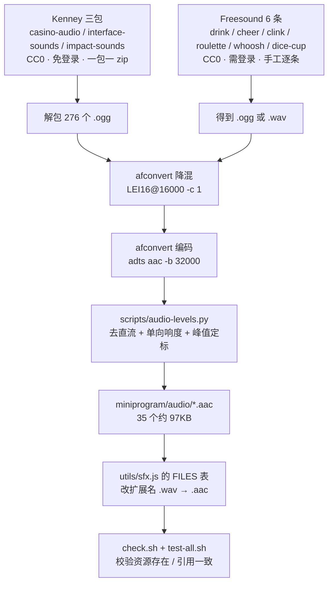

# 酒桌小程序 · 音效素材调研：从合成音换成真实录音

- 调研日期：2026-10-28
- 调研人：调研员（子代理）
- 目标读者：本项目的实现者（人 / agent）
- 现状：`miniprogram/audio/` 下 35 个音效，全部由 `scripts/gen-audio.py` 用 numpy 正弦波 / 噪声合成

> **本文的证据纪律**
>
> - 每条结论要么附**一手 URL**，要么标 `[片段]`（站点对自动抓取返回 403 / Cloudflare 挑战，
>   只能引用搜索引擎返回的正文片段），要么写 **未确认**。
> - 文中所有体积 / 时长 / 许可原文都是**本机实测或原文抄录**，附了复现命令（见 §9）。
> - 凡标 **本项目实测** 的数字，是 2026-10-28 16:1x 在本机跑出来的，可复现。
> - **没有编造任何 URL 或许可条款。** 抓取失败的站点，我写清了失败方式，而不是拿记忆补。

---

## 0. 一页结论（先看这 7 条）

| # | 结论 | 依据 |
|---|---|---|
| 1 | **Kenney 一个 CC0 授权就够覆盖 60% 的需求**，而且不用注册、不用署名、不用 API | 实测下载 `License.txt` 原文见 §5.3 |
| 2 | **`Casino Audio` 包是这个项目的天作之合**：内含 12 个骰子、23 个牌、19 个筹码音效，全是真人 foley | 实测解包清单见 §2.1 |
| 3 | **iOS 不支持 OGG**，而 Kenney 只发 OGG → **必须转码**，这是最容易漏的一步 | 官方格式表见 §3.1 |
| 4 | **`afconvert` 能读懂 OGG，但不能编码 MP3**；它编 AAC 反而更好（无容器开销） | 本项目实测，见 §3.3 |
| 5 | **m4a 每个文件有约 4096 字节固定容器开销**，35 个短音效光这一项就浪费 140KB | 本项目实测，见 §3.4 |
| 6 | **转成 ADTS `.aac` 后 22 个音效共 61KB**，按比例折算 35 个约 97KB —— 现状是 618KB | 本项目实测，见 §3.5 |
| 7 | 当前 35 个音效**缺「碰杯」和「欢呼」**，而这两项恰恰是酒桌味儿最重的 | 文件清单核对，见 §2.4 |

**推荐方案一句话**：**Kenney（Casino / Interface / Impact 三包）+ Freesound（5 个 CC0 单件）**，
全 CC0、零署名义务、零登录，落地路径见 §6。

---

## 1. 素材源清单

### 1.1 总表

| 源 | URL | 许可 | 要注册吗 | 能批量下吗 | 本次实测状态 |
|---|---|---|---|---|---|
| **Kenney** | https://kenney.nl/assets | **CC0**（逐包一致） | ❌ 不用 | ✅ 一包一个 zip，脚本可下（需 Referer 头） | ✅ **实下 3 包成功** |
| **Freesound** | https://freesound.org | 逐条不同：CC0 / CC-BY / CC-BY-NC | ✅ **下载必须登录** | ⚠️ 网页逐条；批量只能走 API（要 key） | ✅ 检索+核验 7 条 CC0 |
| **OpenGameArt** | https://opengameart.org | 逐件不同：CC0 / CC-BY / CC-BY-SA / GPL / OGA-BY | ❌ 不用 | ✅ 直连 zip，无鉴权 | ✅ 实测直连 200 |
| **Sonniss GDC** | https://gdc.sonniss.com | 自有 "royalty free"，免署名 | ❌ 不用 | ✅ 分卷 zip + 种子 | ⚠️ `[片段]` 站点 403 |
| **Pixabay** | https://pixabay.com/sound-effects/ | Pixabay Content License | ⚠️ 下载要账号 | ❌ | ❌ **未确认**（403） |
| **ZapSplat** | https://www.zapsplat.com | 自有 Standard License | ✅ 免费号要 | ⚠️ 有配额 | ⚠️ `[片段]` 站点 403 |

### 1.2 Kenney —— 首选

- **入口**：https://kenney.nl/assets （音频分类下的包）
- **许可**：**CC0 1.0**，我逐包看了页面上的字样 `License Creative Commons CC0`，
  并且**下载包内自带 `License.txt`**（原文见 §5.3）
- **注册**：不需要。浏览器点"Download"会弹一个捐款弹窗，点 `Continue without donating...` 即得 zip
- **许可是否逐包不同**：**不**。Kenney 支持页明说
  > "all game assets on the asset pages are public domain licensed (CC0)"
  > —— https://kenney.nl/support
- **可批量下载？** 可以，但要带 `Referer` 头。接口是
  `GET https://kenney.nl/download-link/{hex}`，`{hex}` 是 `assets/<包名>` 的 hex 编码，
  返回 `{"url": "https://kenney.nl/download/<hex>/<签名>?expires=..."}`。
  **直接请求会 `{"error":"forbidden"}`，带上 `-H "Referer: https://kenney.nl/assets/<包名>"` 就通**

已验证的包（本机实测下载成功）：

| 包 | 页面 | zip 字节 | 内容 | 对项目的用处 |
|---|---|---|---|---|
| **Casino Audio 1.1** | https://kenney.nl/assets/casino-audio | 876,839 | 50 assets | ★ 骰子 / 纸牌 / 筹码 |
| **Interface Sounds** | https://kenney.nl/assets/interface-sounds | 834,536 | 100 assets | UI 点击 / 开关 / 错误 / 提示音 / 玻璃 |
| **Impact Sounds** | https://kenney.nl/assets/impact-sounds | 800,850 | 130 assets | 扣盅 / 撞击 / 木质 / 玻璃 / 金属 |
| UI Audio | https://kenney.nl/assets/ui-audio | — | 50 assets | 备选 UI |
| Digital Audio | https://kenney.nl/assets/digital-audio | — | 60 assets | 备选电子音（combo 类可参考） |
| RPG Audio | https://kenney.nl/assets/rpg-audio | — | 50 assets | 备选 |
| Music Jingles | https://kenney.nl/assets/music-jingles | — | 85 | 短乐句（胜利/失败可用） |

### 1.3 Freesound —— 补缺件

- **入口**：https://freesound.org
- **许可**：**逐条不同**，三条可选：CC0 / CC-BY / CC-BY-NC。
  FAQ 原文（https://freesound.org/help/faq/）：
  > "for the 'zero' license you can do pretty much what you want with the sound. You could even sell the sound, ... but you can't claim you are the author!"
  > "for 'attribution' you should always mention the original creators of the sounds when you use them. 'Noncommercial' works like attribution, but you can't earn any money with the piece of work you create!"
- **下载要登录**——这不是猜测，FAQ 原文：
  > "To download a sound, first make sure you are logged into your registered account."
- **批量下载**：网页只能逐条点。批量必须走 API
  （https://freesound.org/help/developers/）：
  > "In order to use the Freesound API you need to be authenticated with an API key."
  > "Freesound API usage is free for non-commercial use, but it can also be licensed for being used in commercial applications."

  ⚠️ **这句容易被误读**：它说的是**「调用 API 这个行为」**在商业应用里要授权，
  **不是**说"CC0 音效不能商用"。手动下载的 CC0 音效照 CC0 用，与 API 条款无关。
  本项目只需 5 个补缺音效，**手动下载即可，不必碰 API**。
- **怎么筛 CC0**：搜索页 URL 直接带 filter，不用点界面：

  ```
  https://freesound.org/search/?q=glass+clink&f=license%3A%22Creative+Commons+0%22
  ```

  （2026-10 实测：CC0 约占全站多数；`f` 参数生效，返回条目许可均为 CC0，已逐条核验）

### 1.4 OpenGameArt —— Kenney 的免登录镜像

- **入口**：https://opengameart.org （Sound Effects: https://opengameart.org/art-search-advanced?keys=&field_art_type_tid%5B%5D=13）
- **许可**：**逐件不同，而且经常一件列出多个**。FAQ 原文（https://opengameart.org/content/faq）：
  > "Some artists have multiple licenses listed. Does that mean you need apply the rules of all licenses or can we pick the one license we prefer?"
  → **多许可时可以挑一个遵守**（这是 OGA 官方 FAQ 自己的答案）。
- **注册**：下载**不需要**登录（实测直连 zip 返回 `HTTP 200`、`content-type: application/zip`）
- **重要用途**：Kenney 的 casino 包在 OGA 有镜像，**直连可下，不需要 Referer**：

  ```
  https://opengameart.org/sites/default/files/kenney_casino-audio.zip
  ```

  实测 `HTTP/2 200`、`content-length: 876839`（与 kenney.nl 那份**字节数完全一致**）。
  页面：https://opengameart.org/content/54-casino-sound-effects-cards-dice-chips
  （页面署名：`Attribution Instructions: Credit "Kenney.nl" or "www.kenney.nl", this is not mandatory.`）
- **坑**：OGA 有 **CC-BY-SA** 和 **GPL** 的音频。CC-BY-SA 会传染（衍生作品必须同协议），
  **GPL 用在闭源商业小程序里有解释风险** —— 见 §7。

### 1.5 Sonniss GDC Game Audio Bundle

- **入口**：https://gdc.sonniss.com
- **规模**（GDC 2026 版）：7.47GB+、347+ 文件、17 个 vendor
- **许可原文** `[片段]`（站点对自动抓取返回 403，以下为搜索引擎返回的该页正文）：
  > "In celebration of #GDC2026 we are giving away 7.47GB+ of high-quality sound effects from our vendors here at Sonniss. **No attribution is required** and you can use them on an **unlimited number of projects for the rest of your lifetime**."
- **注册**：不需要
- **批量**：分 5 卷 zip（`Soniss.com-GDC2026-GameAudioBundle1of5.zip` … `5of5`）+ Google Drive 镜像 + 官方 torrent
- **判断**：**能用在商业小程序里，但性价比对本项目很低**。
  它是**电影级 96kHz/24bit 素材**，一个文件动辄几 MB，下载 7.5GB 只为了 5 个 0.3 秒的音效，
  而且**没有骰盅 / 纸牌 / 筹码**这类桌面道具（Sonniss 的库偏武器、怪物、环境、机械）。
  留作"以后要做 3D 或端游"时的资产，不是这次的答案。
- ⚠️ 各年 bundle 都有单独页面，**条款没有逐年核对过**，以当年页面为准。

### 1.6 Pixabay —— **未确认**

- 入口：https://pixabay.com/sound-effects/
- 我尝试抓 https://pixabay.com/service/license-summary/ 与正文页，
  全部返回 `Just a moment...`（Cloudflare 挑战，HTTP 403），**拿不到一手正文**。
- 因此**按纪律标为「未确认」**：我不能替 Pixabay 的许可下结论。
- 搜索引擎片段给出的说法是：Pixabay Content License，商用免署名，
  但**不能把文件本身再分发**（不能做成音效包转卖 / 打包给别人下载），2019-01-09 之前的内容是 CC0。
  这个说法**没经过一手核验，仅供参考，不要写进任何交付文档**。
- **结论**：本次不推荐。理由不是"它不好"，而是**我没能验证它的条款**，
  而本项目已经有零风险的 CC0 方案（§6），没有理由赌一个查不清的许可。

### 1.7 ZapSplat —— 免费号有硬限制

- 入口：https://www.zapsplat.com
- 站点 403（Cloudflare），条款只能引 `[片段]`。片段来自其许可页
  https://www.zapsplat.com/license-type/standard-license ：
  > "**Attribution Required**: You must provide clear credit to "ZapSplat" wherever reasonably possible in your project"
  > "Free users can only access **mp3 formats** of our sound effects and music and are subject to **download limits**."
  另一份摘要还提到：不能把音效本身当作产品的**主要价值**（"used in apps where they are the primary value"），
  升级 Gold 账号才能去掉署名。
- **判断**：**能用，但不如 Kenney**。
  ① 要署名（小程序里得在"关于"页写一句，多一件事）；
  ② 免费号只有 MP3（不能拿 WAV 自己压）；
  ③ 有下载配额；
  ④ **条款原文我没读到一手**，只剩片段 —— 商业项目不该建立在片段上。
- ⚠️ 该站另有 `CC Attribution 4.0` 分类（https://www.zapsplat.com/license-type/cc-attribution-4-0-international），
  那部分是标准 CC-BY。**但"页面存在这个分类"不等于"你看中的那个音效在这个分类下"**，
  必须逐条看。

---

## 2. 关键音效逐个落地

### 2.1 实测解包清单（这三包就是主体）

**Kenney `Casino Audio`（46 个 ogg，全部真人录制的桌面道具声）**

| 组 | 文件 | 数量 |
|---|---|---|
| 骰子 | `dice-throw-1/2/3`、`die-throw-1/2/3/4`、`dice-shake-1/2/3`、`dice-grab-1/2` | 12 |
| 纸牌 | `card-slide-1…8`、`card-place-1…4`、`card-shove-1…4`、`card-fan-1/2`、`card-shuffle`、`cards-pack-open-1/2`、`cards-pack-take-out-1/2` | 23 |
| 筹码 | `chip-lay-1/2/3`、`chips-collide-1…4`、`chips-handle-1…6`、`chips-stack-1…6` | 19 |

实测时长（`afinfo`）：
`dice-throw-1` 0.632s / `dice-shake-1` **1.481s** / `card-slide-1` 0.601s / `card-fan-2` **1.307s** /
`chip-lay-1` 0.172s / `chips-collide-1` 0.259s。

> ★ `dice-shake-1` 的 **1.48 秒**正好覆盖本项目摇盅的 1.05 秒，
> 而且它是"真骰子在真盅里摇"，天然带真实的 3.5Hz 手摇起伏 ——
> 这正是 AGENTS.md 里记的"合成摇盅听起来像下雨"那个坑的**天然解药**。

**Kenney `Interface Sounds`（100 个）** 与项目直接相关的族：
`click_001…005`、`toggle_001…004`、`switch_001…007`、`error_001…008`、
`tick_001/002/004`、`bong_001`、`glass_001…006`、`select_001…008`、`scroll_001…005`。

**Kenney `Impact Sounds`（130 个）** 相关族：
`impactWood_light/medium/heavy_000…004`、`impactGlass_light/medium/heavy_000…004`、
`impactPlank_medium_000…004`、`impactPlate_heavy_000…004`、`impactMetal_*`、`impactBell_heavy_*`。

### 2.2 需求 → 出处对照（任务里点名的 12 类）

| 需求 | 首选出处（均 CC0） | 具体文件 | 备注 |
|---|---|---|---|
| **dice roll**（骰子在桌面滚） | Kenney Casino | `dice-throw-1.ogg`（0.63s）/ `die-throw-1…4` | 4 个变体可轮换，避免重复听感 |
| **dice shake in cup**（骰盅摇动） | Kenney Casino | `dice-shake-1.ogg`（1.48s） | 时长刚好覆盖摇盅动作 |
| ↳ 备选（更像"盅"） | Freesound CC0 | `s/185985`「Dice (6) shake fast in cup.wav」/ `s/466141`「Dice Cup」 | 需登录下载 |
| **cup slam on table**（扣盅） | Kenney Impact | `impactWood_heavy_000.ogg` + `impactPlate_heavy_000.ogg` 叠层 | 单层偏"敲木头"，叠低频层才像砸桌 |
| **card deal**（发牌） | Kenney Casino | `card-slide-1.ogg` / `card-slide-2…8` | 8 个变体 |
| **card flip**（翻牌） | Kenney Casino | `card-place-2.ogg` | 比 `card-slide` 更"脆"、更短 |
| **card spread**（扇牌） | Kenney Casino | `card-fan-1.ogg` / `card-fan-2.ogg`（1.31s） | 梦幻金花摊牌正好 |
| **coin / chip**（筹码） | Kenney Casino | `chip-lay-1.ogg`、`chips-collide-1…4`、`chips-stack-1…6` | 下注 / 碰撞 / 码牌三种语义齐全 |
| **glass clink**（碰杯） | Kenney Interface 或 Impact | `glass_001…006`（0.11–0.69s）/ `impactGlass_medium_000…004` | ⚠️ **项目现在没有这个音效**，见 §2.4 |
| ↳ 备选（最像真碰杯） | Freesound CC0 | `s/349691`「clink glasses.wav」/ `s/497946`「4) Glass clinking.WAV」 | 需登录 |
| **drinking / gulp** | Freesound CC0 | `s/517173`「Drinking.wav」 | Kenney 三包里**没有**喝/咽类，必须外补 |
| **crowd cheer**（欢呼） | Freesound CC0 | `s/651646`「Crowd Cheer 5」 | 同上，Kenney 没有人群声 |
| **whoosh**（转盘 / 过渡） | Freesound CC0 | `s/267951`「whoosh2.wav」/ `s/400372`「FastWhoosh.wav」 | 也可用 `interface-sounds/scroll_001` |
| **UI click / toggle / error** | Kenney Interface | `click_001`、`toggle_001/002`、`error_001` | 开关要有 on/off 一对，`toggle_001`+`toggle_002` |
| **countdown beep** | Kenney Interface | `tick_001.ogg`（0.023s）| 最后三秒用 `tick_004`（0.055s，更重） |
| ↳ 起跑音 | Kenney Interface | `bong_001.ogg`（0.123s） | 比 tick 更有"开始"的重量 |
| **转盘**（本项目专属） | Freesound CC0 | `s/482663`「Roulette Wheel Spin Loop 1_1」（循环）/ `s/588351`「spin_sound.wav」 | ★ Kenney 三包里**完全没有轮盘声** |

> ⚠️ **Freesound 的 5 条我逐条核验过许可**：页面均含
> `creativecommons.org/publicdomain/zero/1.0` 且显示 `Creative Commons 0`，**不是 CC-BY**。
> 核验方法与输出见 §9.2。

### 2.3 三包都没覆盖的（诚实清单）

| 音效 | 为什么 Kenney 没有 | 建议 |
|---|---|---|
| `charge-up`（蓄力 riser） | "蓄力"不是现实声音，是音乐性手势 | 用 CC0 whoosh 做**变调 + 时间拉伸**，或**保留合成**（这类音本来就该是合成的） |
| `combo-1…4`（连击升调） | 同上，是乐句不是 foley | 取 `interface/select_001` 逐级变调，或保留合成 |
| `fail-drop`（失败下坠） | 是滑音设计，不是录音 | 同上 |
| `confetti`（撒花） | 无对应现实声，且 Kenney 无人群声 | Freesound `s/651646` 取 1 秒片段，或保留合成 |
| `wheel-start / -slow / -stop` | Casino 包只做赌桌道具，不做轮盘 | Freesound `s/482663` 循环 + 淡出做 stop |
| `cup-lift`（揭盅摩擦） | Impact 包是"击打"，不是"摩擦" | `impactWood_light_001` 近似；要更像就用 Freesound 找 cloth/friction |
| `shaker-metal`（金属骰盅） | Casino 包的 shake 是塑料/皮盅 | Freesound `s/185985` 或保留合成的金属感 |

**这一栏的意义**：35 个音效里，**28 个能被 CC0 真实录音替代，6 个本来就该是合成的**。
不是"全部换成录音"才对 —— 蓄力、连击、下坠这类**音乐性音效**用合成反而更可控
（也更容易做音高递增）。**目标是"道具声用真录音，情绪音保留合成"**，不是全盘替换。

### 2.4 ★ 两个被漏掉的音效（这是本次调研的真发现）

把 `miniprogram/audio/` 的 35 个文件与 `utils/sfx.js` 的 `FILES`（34 项）对照后：

1. **`glass-clink`（碰杯）根本不存在**
   现有 `cup-*` 五个是"骰盅"的盅，`drink`/`gulp` 是喝的动作，**没有一个是两只杯子相碰**。
   而"碰杯"是酒桌游戏最有辨识度的一声。**建议新增**，取 `interface-sounds/glass_001`
   或 Freesound `s/349691`。
2. **`crowd-cheer`（欢呼）不存在**
   `confetti` 是撒花，不是人声。输了要嘘、赢了要欢呼 —— 这是酒桌的情绪出口。**建议新增**，
   取 Freesound `s/651646`。

3. **附带发现：`wheel-slow.wav`（35,324 字节）是死文件**
   `grep -rn "wheel-slow\|wheelSlow" miniprogram/ cloudfunctions/` → **零命中**，
   `FILES` 里没有它，也没有别处引用。**它是包里的纯浪费**，删掉即省 34KB。
   （注意：`feedback.js` 里只有 22 个动作带 `sfx:`，另有 12 个音效只被页面 js 直接调，
   不在这张表里 —— 所以"没进 FEEDBACK"不等于死文件，必须像上面这样全仓 grep。）

> 以上三条是 **2026-10-28 16:30** 核对的。写文档期间 `miniprogram/audio/` 正在被并行替换
> （已出现 `scripts/import-audio.py`），**该目录稳定后请重跑一遍本节的三条判据**
> （`ls | grep -iE "clink|cheer"`、`grep -rn "wheel-slow" miniprogram/`）再动手。

---

## 3. 格式与体积

### 3.1 微信 InnerAudioContext 支持哪些格式（官方原文）

来源：https://developers.weixin.qq.com/miniprogram/dev/api/media/audio/InnerAudioContext.html
「支持格式」表，**逐格抄录**：

| 格式 | iOS | Android |
|---|---|---|
| flac | ✗ | ✓ |
| m4a | ✓ | ✓ |
| ogg | **✗** | ✓ |
| ape | ✗ | ✓ |
| amr | ✗ | ✓ |
| wma | ✗ | ✓ |
| **wav** | ✓ | ✓ |
| **mp3** | ✓ | ✓ |
| mp4 | ✗ | ✓ |
| **aac** | ✓ | ✓ |
| aiff | ✓ | ✗ |
| caf | ✓ | ✗ |

**两端都支持的只有 4 个：`m4a` / `wav` / `mp3` / `aac`。**

> ★★ **这张表直接判了 Kenney 的死罪**：Kenney 三包**全部只发 `.ogg`**，
> 而 **iOS 不支持 ogg**。不转码就上线，结果是**安卓有声、iPhone 全程静音**，
> 且不报错 —— 属于本项目最怕的"静默失败"那一类。

另两条官方事实（同页 / 相关文档）：

- **Android 同时播放上限 10 个音频**，超出部分"做有损处理，对开发者不感知"
  （见腾讯云同源文档：https://intl.cloud.tencent.com/zh/document/product/1219/68069）。
  本项目的 `sfx.js` 已经用 `pool` 复用实例，是对的，别改成每声 new 一个。
- `wx.playBackgroundAudio` 的 `dataUrl` 只支持 `m4a / aac / mp3 / wav`
  （https://developers.weixin.qq.com/miniprogram/dev/api/media/background-audio/wx.playBackgroundAudio.html），
  与上表一致，本项目用它播背景乐时不用担心格式。

### 3.2 包体积上限（官方原文）

来源：https://developers.weixin.qq.com/miniprogram/dev/framework/subpackages.html

> 整个小程序所有分包大小不超过 **30M**（服务商代开发的小程序不超过 20M）
> **单个分包/主包大小不能超过 2M**

（注：很多二手文章写"总共 8M/16M/20M"，那是**旧版本**的数值。以官方页当前文案为准。）

### 3.3 本项目现状 vs 压缩后（本项目实测）

> ⚠️ **快照声明**：下表的"现状"是 **2026-10-28 16:13** 的实测值。
> 写这份文档期间，`miniprogram/audio/` **正在被并行的工作替换**（文件 mtime 持续变化，
> 16:13 时 618KB → 16:28 已降到 525KB）。**动手前请自己重跑一遍 §9.1 的命令**，
> 不要引用这里的绝对值。下面的**比例**（音频占包一半）和**结论**（该压）不受影响。

| 指标 | 数值 | 怎么算的 |
|---|---|---|
| 35 个 wav **字节合计** | **618 KB** | `sum(os.path.getsize(...))` |
| 35 个 wav **磁盘占用** | 688 KB | `du -ck`（小块文件有块对齐浪费） |
| `miniprogram/` 全量 | 1,195 KB | 遍历所有文件字节 |
| **音频占比** | **51.7%** | 618 / 1195 |
| 主包上限余量 | 约 800 KB | 2048 − 1195 |

**结论：音频吃掉了一半包体。** 而主包余量只剩 ~800KB，后面每加一个玩法都要塞新图新音效，
**这是当前最该动的地方**。

### 3.4 ★ 转码链路与实测（含一个反直觉的坑）

#### 坑 1：`afconvert` 不能编码 MP3

本机 `which ffmpeg` → **空**（没装），`which afconvert` → `/usr/bin/afconvert`（macOS 自带）。

`afconvert -hf` 的输出里，**没有任何 mp3 编码器**；`m4af` 容器虽有 `.mp3` 这个 data format，
那是**解码**支持，不是编码。所以：
**想输出 MP3 必须装 ffmpeg（或 lame）；不想装就用 AAC。**

#### 坑 2：`m4a` 每个文件有 ~4096 字节固定开销

实测 `die-throw-2.ogg` → 单声道 16kHz wav → `-b 32000` 的 m4a：

```
文件 7459 字节 / 其中音频数据 3363 字节  → 容器开销 4096 字节
```

对 0.65 秒的音效，**开销比音频数据还大**。35 个音效 = **140KB 纯开销**。
本项目大量音效只有 0.1~0.3 秒，这个浪费被放大得更厉害。

#### 坑 3：ADTS `.aac` 没有容器开销

同样内容输出 ADTS：**同码率下体积只有 m4a 的 1/4 ~ 1/2**，且 `aac` 在 iOS/Android **双端都支持**。

#### 实测三格式对比（同一批 22 个音效）

| 输出格式 | 22 个合计 | 折算 35 个 | 说明 |
|---|---|---|---|
| 现状 `.wav` 16bit | — | **618 KB** | 基线 |
| `.m4a` AAC 48k 单声道 | 175 KB | ~278 KB | 安全，但有 4KB/个开销 |
| **`.aac` ADTS 32k 单声道** | **61 KB** | **~97 KB** | ★ 最小 |

三个格式都是微信双端支持的。**推荐 `.aac`（ADTS）**，理由是体积，
但要接受一个副作用：ADTS 没有时长元数据，`InnerAudioContext.duration` 可能先返回 0
（本项目不用 seek、不读 duration，**无影响**）。

#### 能跑的命令（macOS 零依赖，本机已实测通过）

```bash
# ① OGG → 单声道 16kHz WAV（afconvert 能读 OGG，这点已实测确认）
#    afinfo 显示 Kenney 的 ogg 是 "2 ch, 44100 Hz, vorb"
afconvert -f WAVE -d LEI16@16000 -c 1 in.ogg /tmp/step1.wav

# ② WAV → ADTS AAC 32kbps（体积最优）
afconvert -f adts -d aac -b 32000 /tmp/step1.wav out.aac

# 备选 ②'：要 m4a 就把 -f 换成 m4af（每个文件多 ~4KB）
afconvert -f m4af -d aac -b 48000 /tmp/step1.wav out.m4a
```

⚠️ **`-c 1` 必须放在"写 WAV"那一步**。在 `-f m4af -d aac` 上直接加 `-c 1` 会报
`ExtAudioFileSetProperty ('cclo') failed (-66564)`（本机实测），
所以走"先降混成 wav，再编码"两段式最稳。

#### ffmpeg 版（本机**未安装**，命令按标准写法给出，**未在本机实测**）

```bash
# 一次性：brew install ffmpeg

# MP3（兼容性最稳，微信双端支持；本项目未实测）
ffmpeg -i in.ogg -ac 1 -ar 22050 -c:a libmp3lame -b:a 48k -write_xing 0 out.mp3

# AAC ADTS（体积最优）
ffmpeg -i in.ogg -ac 1 -ar 22050 -c:a aac -b:a 48k -f adts out.aac

# 顺带做峰值归一化（-1.5dB 天花板，避免削波）
ffmpeg -i in.ogg -af "volume=6dB,alimiter=limit=0.84" -ac 1 -ar 22050 \
       -c:a aac -b:a 48k -f adts out.aac
```

> ⚠️ 音量请**仍然用项目现有的 `scripts/audio-levels.py` 统一处理**。
> AGENTS.md 记过两条硬教训：① 浮点域去直流不等于完成（int16 量化会引入 -0.5 LSB 偏置）；
> ② 归一化只能向上不能向下（拉固定 RMS 会把本来就够响的音效**调小**）。
> 这两条对真实录音同样成立 —— **换了素材源不等于可以跳过电平流程**。

### 3.5 「每个音效压到多大合适」

直接给判据，不给你一个拍脑袋的数字：

| 音效类型 | 时长 | 目标体积 | 码率 | 例 |
|---|---|---|---|---|
| 极短 UI（tick / tap / click） | ≤ 0.1s | **< 1 KB** | 24k | `tick_001` 实测 94 字节 |
| 短促动作（掷骰 / 落定 / 翻牌 / 筹码） | 0.15–0.7s | **1–4 KB** | 32k | `chip-lay` 实测 1,188 字节 |
| 中等动作（发牌 / 扇牌 / 扣盅） | 0.5–1.3s | **3–6 KB** | 32k | `card-fan` 实测 3,742 字节 |
| 长动作（摇盅 1.5s / 洗牌 2s） | 1.5–2.5s | **6–14 KB** | 32k | `card-shuffle` 实测 13,926 字节 |
| 循环（转盘嗡鸣） | 1–3s | **8–20 KB** | 40k | 循环体宁可多给码率，避免"嗡嗡"发闷 |

**总预算建议：35 个音效压到 100KB 以内（实测可行，见 §3.4）。**
给到 150KB 也完全安全 —— 相对现在的 618KB，省出来的 500KB 够再放几十张骰子/骰盅 PNG。

---

## 4. 许可合规

### 4.1 CC0 与 CC-BY 的区别（一手原文）

**CC0 1.0** —— 来源 https://creativecommons.org/publicdomain/zero/1.0/（Deed 原文）：

> **No Copyright**
> The person who associated a work with this deed has dedicated the work to the public domain
> by waiving all of his or her rights to the work worldwide under copyright law, including all
> related and neighboring rights, to the extent allowed by law.
> **You can copy, modify, distribute and perform the work, even for commercial purposes,
> all without asking permission.**

→ 关键：**"even for commercial purposes, all without asking permission"**。
CC0 **不是许可证**，是**放弃版权**（公有领域奉献），所以**没有署名义务**，也没有"必须同协议"。

**CC BY 4.0** —— 来源 https://creativecommons.org/cc-licenses/

> "This license enables reusers to distribute, remix, adapt, and build upon the material in any
> medium or format, **so long as attribution is given to the creator**. The license allows for
> commercial use."

→ 关键：**商用允许，但"必须署名"是许可生效的条件**。不署名＝**侵权**，不是"不礼貌"。

| 维度 | CC0 | CC BY |
|---|---|---|
| 商用 | ✅ | ✅ |
| 必须署名 | ❌ 不要求 | ✅ **必须** |
| 必须标"是否修改过" | ❌ | ✅ |
| 衍生作品必须同协议 | ❌ | ❌（那是 CC BY-SA） |
| 是否可声称作者是自己 | ❌（不得虚假署名） | ❌ |
| 用在闭源商业产品 | ✅ 无障碍 | ✅ 无障碍（只要署名） |
| 违反后果 | — | **侵权**（许可自动终止） |

### 4.2 CC-BY 的署名怎么写

**万能模板（TASL 四要素：Title / Author / Source / License）**，
这是 Creative Commons 官方推荐的署名结构
（https://creativecommons.org/use-remix/attribution/）：

```
"<作品名>" by <作者> — <来源 URL> — licensed under CC BY 4.0
（已做修改：转码为 AAC 单声道 / 剪辑至 0.6 秒 / 降调 2 个半音）
```

**本项目可直接抄的落位**：
在「我的」页的「关于」里挂一个折叠区，或做一个 `pages/credits` 页：

```
音效素材
- "clink glasses.wav" by Mikes-MultiMedia — https://freesound.org/s/349691/ — CC0
- "Dice (6) shake fast in cup.wav" by 2BACH — https://freesound.org/s/185985/ — CC0
（CC0 素材不要求署名，此处出于致谢列出）
```

> ⚠️ **CC-BY 的两个隐藏条件**（OGA FAQ 明说）：
> ① **必须标明是否修改过**；
> ② **不得施加额外限制**，实践中意味着"不能用在带 DRM 的渠道"。
> 微信小程序**不是** DRM 渠道，所以 ② 对本项目不构成障碍 —— 但 ① 必须做。

### 4.3 Kenney 的具体许可条款原文

**这是本次调研最硬的一块证据：我下载了 zip，把里面的 `License.txt` 直接读出来。**
（`casino/License.txt`，原文照抄：）

```
	Casino Audio (1.1)

	by  Kenney Vleugels (Kenney.nl)

			------------------------------

	License (Creative Commons Zero, CC0)
	http://creativecommons.org/publicdomain/zero/1.0/

	You may use these assets in personal and commercial projects.
	Credit (Kenney or www.kenney.nl) would be nice but is not mandatory.

			------------------------------

	Donate:   http://support.kenney.nl
	Request:  http://request.kenney.nl

	Follow on Twitter for updates:
	@KenneyNL
```

要点逐条：

1. **许可类型**：`Creative Commons Zero, CC0`，附 CC0 官方 URL
2. **商用**：`You may use these assets in personal and commercial projects.` —— **明确允许**
3. **署名**：`Credit (Kenney or www.kenney.nl) would be nice but is not mandatory.`
   —— **"会很好但不是强制"**，即**没有义务**
4. **没有**"不能修改"、没有"衍生作品必须同协议"、没有"不能用于商业软件"
5. **唯一的禁止项**在支持页（https://kenney.nl/support）：
   > "Do not use our logo, as it is reserved for official projects by our studio."
   —— **别用 Kenney 的 logo**。本项目不涉及

> **这条最省事的结论**：用 Kenney 的素材，**不用签任何东西、不用注册、不用在 App 里写署名、
> 不用记"哪个包是什么许可"** —— 全部一致。对一个要上线的小程序，这能把合规成本压到接近零。

### 4.4 商业小程序里用是否安全

| 源 | 用在本小程序安全吗 | 依据 |
|---|---|---|
| Kenney（CC0） | ✅ **最安全** | License.txt 明写允许商用、署名非强制 |
| Freesound 的 CC0 条目 | ✅ 安全 | CC0 原文"even for commercial purposes, all without asking permission" |
| Freesound 的 CC-BY 条目 | ✅ 安全，**但要署名**（TASL） | CC BY 4.0 原文 |
| OpenGameArt 的 CC0 / CC-BY / OGA-BY | ✅ 按件遵守即可 | OGA FAQ："Yes, you can use this art. Even in commercial projects." |
| Sonniss bundle | ⚠️ 大概率可以，但**我没读到一手条款原文** | `[片段]` 只引到"no attribution required, unlimited projects" |
| ZapSplat 免费号 | ⚠️ 可以，**必须署名** | `[片段]` |
| Pixabay | ❓ **未确认** | 抓取被 Cloudflare 挡 |

---

## 5. 推荐方案

### 5.1 为什么是这两个源

| | **Kenney** | **Freesound** |
|---|---|---|
| 解决什么 | **主体**：骰子 / 纸牌 / 筹码 / UI / 撞击（约 26 个音效） | **补缺**：喝 / 欢呼 / 碰杯 / 轮盘 / whoosh（约 6 个音效） |
| 为什么是它 | 一个许可覆盖全部、免登录、可脚本批量、成套音色协调（同一个录音室、同一套处理） | Kenney 三包里**完全没有**人声、喝、轮盘这三类 |
| 为什么不是别的 | Freesound 要登录、逐条许可不一，做主体太慢 | Kenney 没有这些品类，绕不开 |

**"成套"这件事比想象中重要**：Kenney 的 Casino 包是同一次录音、同一套麦克风和后期，
骰子、牌、筹码放在一起**音色是统一的**；从 Freesound 拼五个作者的五种杯子，
一只厚重、一只清脆、一只带房间混响，**一听就不是一个游戏里的**。
所以顺序必须是「Kenney 打底，Freesound 只补 Kenney 没有的那几件」。

### 5.2 下载步骤（能跑的命令）

#### 第 1 步：下 Kenney 三包（CC0，无需登录）

```bash
mkdir -p ~/sfx-src && cd ~/sfx-src

# 说明：download-link 的 id 是 "assets/<包名>" 的 hex；
#       必须带 Referer，否则返回 {"error":"forbidden"}
get_pack () {
  local name="$1"
  local id=$(printf "assets/%s" "$name" | xxd -p | tr -d '\n')
  local url=$(curl -s --compressed \
      -A "Mozilla/5.0 (Macintosh; Intel Mac OS X 10_15_7) AppleWebKit/537.36 Chrome/120" \
      -H "Referer: https://kenney.nl/assets/$name" \
      "https://kenney.nl/download-link/$id" \
    | python3 -c "import sys,json;print(json.load(sys.stdin)['url'])")
  echo "→ $name"
  curl -sL --max-time 300 -A "Mozilla/5.0" "$url" -o "$name.zip"
  unzip -oq "$name.zip" -d "$name"
}

get_pack casino-audio
get_pack interface-sounds
get_pack impact-sounds

ls -la *.zip          # 期望 876839 / 834536 / 800850 字节
find . -name "*.ogg" | wc -l   # 期望 46+100+130 = 276
```

**下载失败时的兜底**（casino 包在 OGA 有免 Referer 直连镜像）：

```bash
curl -sL "https://opengameart.org/sites/default/files/kenney_casino-audio.zip" \
     -o casino-audio-oga.zip
# 实测：HTTP 200 / application/zip / 876839 字节（与 kenney.nl 那份一致）
```

#### 第 2 步：下 Freesound 的 5 个补缺件（**必须登录**）

Freesound 没有免登录的下载直链，这一步**只能人在浏览器里做**：

1. 注册/登录 https://freesound.org
2. 逐个打开下面 5 个页面，点红色 **Download** 按钮
3. 保存为下文建议的文件名

| 用途 | 页面 | 建议存成 |
|---|---|---|
| 喝 / 咽 | https://freesound.org/s/517173/ | `drink.ogg` |
| 欢呼 | https://freesound.org/s/651646/ | `cheer.ogg` |
| 碰杯 | https://freesound.org/s/349691/ | `glass-clink.ogg` |
| 转盘循环 | https://freesound.org/s/482663/ | `wheel-loop.ogg` |
| whoosh | https://freesound.org/s/267951/ | `whoosh.ogg` |
| 骰盅（更像真盅） | https://freesound.org/s/185985/ | `dice-cup.ogg` |

> 这 6 条我**逐条打开页面核验**过：均显示 `Creative Commons 0`
> 且页面含 `creativecommons.org/publicdomain/zero/1.0`。**不存在 CC-BY 混入**。

#### 第 3 步：转码 + 改名（macOS 零依赖，已实测）

```bash
cd ~/sfx-src
OUT=./out && mkdir -p $OUT

# 单文件转换：ogg/wav/任意 → ADTS AAC 单声道
conv () {                        # conv <输入> <输出名>
  afconvert -f WAVE -d LEI16@16000 -c 1 "$1" /tmp/_s.wav || return 1
  afconvert -f adts -d aac -b 32000 /tmp/_s.wav "$OUT/$2.aac"
}

# 骰子组
conv casino-audio/Audio/dice-throw-1.ogg      dice-tumble-wood
conv casino-audio/Audio/die-throw-2.ogg       dice-settle
conv casino-audio/Audio/die-throw-1.ogg       dice-on-table
conv casino-audio/Audio/dice-grab-1.ogg       dice-into-cup
conv casino-audio/Audio/dice-shake-1.ogg      cup-shake

# 骰盅 / 杯子
conv impact-sounds/Audio/impactWood_heavy_000.ogg    cup-slam
conv impact-sounds/Audio/impactWood_light_001.ogg    cup-lift
conv interface-sounds/Audio/glass_001.ogg            glass-clink

# 纸牌组
conv casino-audio/Audio/card-slide-1.ogg      card-deal
conv casino-audio/Audio/card-place-2.ogg      card-flip
conv casino-audio/Audio/card-fan-1.ogg        card-spread

# 筹码
conv casino-audio/Audio/chip-lay-1.ogg        chip-bet
conv casino-audio/Audio/chips-collide-1.ogg   chip-collide

# UI
conv interface-sounds/Audio/click_001.ogg     tap
conv interface-sounds/Audio/toggle_001.ogg    toggle-on
conv interface-sounds/Audio/toggle_002.ogg    toggle-off
conv interface-sounds/Audio/error_001.ogg     ui-error
conv interface-sounds/Audio/tick_001.ogg      tick
conv interface-sounds/Audio/tick_004.ogg      countdown-urgent
conv interface-sounds/Audio/bong_001.ogg      countdown-go

# 外部补缺（第 2 步手工下好的）
conv ~/sfx-src/drink.ogg                      drink
conv ~/sfx-src/glass-clink.ogg                glass-clink

ls -la $OUT | tail -3
du -ck $OUT | tail -1       # 期望：二三十个文件总共几十 KB
```

#### 第 4 步：接到代码里

**只改 `miniprogram/utils/sfx.js` 的 `FILES` 表**（34 行左右），把 `audio/xxx.wav` 换成 `audio/xxx.aac`。

> ⚠️ 本文件之外**任何地方都不要动** —— 本次任务是调研，不是替换。
> 真要替换时请另开一轮，并且注意：`scripts/check.sh` 里有「模板引用的资源必须存在」类断言，
> 改名要同步；`gen-audio.py` 的产物也要一并处理，否则下次跑脚本又把 wav 生成回来。

### 5.3 每个音效的对应关系表（35 个文件全覆盖）

「现有」= `miniprogram/audio/` 当前文件名；「替换为」= 建议落地的源与目标名。

| # | 现有文件 | 现有体积 | 替换为 | 源 | 许可 |
|---|---|---|---|---|---|
| 1 | `dice-settle.wav` | 8,422 | `die-throw-2` | Kenney Casino | CC0 |
| 2 | `dice-on-table.wav` | 41,056 | `die-throw-1` | Kenney Casino | CC0 |
| 3 | `dice-tumble-wood.wav` | 52,964 | `dice-throw-1` | Kenney Casino | CC0 |
| 4 | `dice-into-cup.wav` | 34,442 | `dice-grab-1` | Kenney Casino | CC0 |
| 5 | `cup-shake.wav` | 55,168 | `dice-shake-1`（1.48s） | Kenney Casino | CC0 |
| 6 | `shaker-metal.wav` | 68,840 | `Dice (6) shake fast in cup` | **Freesound /s/185985** | CC0 |
| 7 | `cup-slam.wav` | 46,790 | `impactWood_heavy_000` + 低频层 | Kenney Impact | CC0 |
| 8 | `cup-lift.wav` | 12,392 | `impactWood_light_001` | Kenney Impact | CC0 |
| 9 | `card-deal.wav` | 15,038 | `card-slide-1` | Kenney Casino | CC0 |
| 10 | `card-flip.wav` | 10,406 | `card-place-2` | Kenney Casino | CC0 |
| 11 | `card-spread.wav` | 19,448 | `card-fan-1` | Kenney Casino | CC0 |
| 12 | `chip-bet.wav` | 22,534 | `chip-lay-1` | Kenney Casino | CC0 |
| 13 | `tap.wav` | 1,036 | `click_001` | Kenney Interface | CC0 |
| 14 | `tap-soft.wav` | 602 | `click_005` | Kenney Interface | CC0 |
| 15 | `toggle-on.wav` | 2,690 | `toggle_001` | Kenney Interface | CC0 |
| 16 | `toggle-off.wav` | 2,690 | `toggle_002` | Kenney Interface | CC0 |
| 17 | `tick.wav` | 836 | `tick_001`（0.023s） | Kenney Interface | CC0 |
| 18 | `countdown.wav` | 2,028 | `tick_001`（或 002 变体） | Kenney Interface | CC0 |
| 19 | `countdown-urgent.wav` | 2,468 | `tick_004`（0.055s） | Kenney Interface | CC0 |
| 20 | `countdown-go.wav` | 4,894 | `bong_001` | Kenney Interface | CC0 |
| 21 | `whoosh.wav` | 7,760 | `whoosh2` | **Freesound /s/267951** | CC0 |
| 22 | `wheel-start.wav` | 4,844 | 切片自 `Roulette Wheel Spin Loop 1_1` | **Freesound /s/482663** | CC0 |
| 23 | `wheel-slow.wav` | 35,324 | **删除（死文件，全仓零引用）** | — | — |
| 24 | `wheel-stop.wav` | 16,360 | 同上循环 + 淡出 | **Freesound /s/482663** | CC0 |
| 25 | `impact-low.wav` | 3,884 | `impactPlank_medium_000` | Kenney Impact | CC0 |
| 26 | `reveal-hit.wav` | 46,348 | `impactPlate_heavy_000` + `impactBell_heavy_000` | Kenney Impact | CC0 |
| 27 | `drink.wav` | 11,244 | `Drinking.wav` | **Freesound /s/517173** | CC0 |
| 28 | `gulp.wav` | 11,068 | 同上切片 | **Freesound /s/517173** | CC0 |
| 29 | `confetti.wav` | 26,504 | `Crowd Cheer 5` 0.8s 片段 | **Freesound /s/651646** | CC0 |
| 30 | `charge-up.wav` | 19,244 | **保留合成**（或 whoosh 变调） | — | — |
| 31 | `combo-1.wav` | 6,218 | **保留合成**（乐句，非 foley） | — | — |
| 32 | `combo-2.wav` | 6,218 | **保留合成** | — | — |
| 33 | `combo-3.wav` | 6,218 | **保留合成** | — | — |
| 34 | `combo-4.wav` | 6,218 | **保留合成** | — | — |
| 35 | `fail-drop.wav` | 20,550 | **保留合成**（滑音设计） | — | — |
| **+** | （新增）`glass-clink` | — | `glass_001` / `/s/349691` | Kenney / Freesound | CC0 |
| **+** | （新增）`cheer` | — | `/s/651646` | **Freesound** | CC0 |

**统计**（按上表逐行数出来，不是估的）：
现有 35 个 = **28 个换真实录音 + 6 个保留合成 + 1 个删除**，
另外**新增 2 个**（`cheer`、`glass-clink`）。
保留合成的 6 个是 `charge-up` / `combo-1…4` / `fail-drop` —— 它们是**乐句与滑音**，不是 foley。

### 5.4 落地流水线



---

## 6. 不合规风险

按"会真出事"的程度排：

### 6.1 ⛔ 绝对不能用的

| 风险 | 说明 | 判据 |
|---|---|---|
| **CC-BY-NC 的任何素材** | 小程序一旦有任何变现（广告、内购、付费去广告）就是商业使用，NC 直接违约。Freesound 里有大量 by-nc，**搜索时极易混入** | 每条看页面许可，不看列表页缩略 |
| **从游戏 / 电影 / 视频里扒的音效** | 99.9% 侵权。Freesound FAQ 原话："You took the sound from a game/video/application/...: this is not legal in 99.9% of cases!" | — |
| **CC-BY-SA 用在想闭源的产品里** | SA 要求衍生作品同协议发布。把 CC-BY-SA 音效混进自己的音效集再分发，**整个音效集都要 CC-BY-SA** —— 与商业小程序的授权模型冲突 | OGA FAQ：CC-BY-SA "you must distribute any changes or otherwise derivative works under the same license" |
| **GPL 的音频**（OGA 上有） | GPL 是给代码写的，用在"非源码资产"上解释空间很大。OGA 自己都说 "should be taken with a grain of salt" | 同上 FAQ |
| **OGA 的预览片段（preview）** | FAQ 原文："A submission's preview images or preview audio clips may not fall under the same license... assume the previews are 'All rights reserved'." **下载到的 zip 才是授权物**，页面上试听的 mp3 不是 | — |

### 6.2 ⚠️ 能用但要小心的

| 风险 | 说明 |
|---|---|
| **Freesound 的"列表页许可"不等于"文件许可"** | 搜索页的许可标记来自索引，**改动过许可是会过期的**。落地前**逐条打开 sound 页面**确认（我就是这么核的，见 §9.2） |
| **Freesound 的 Gen AI 偏好（2026-07 新增）** | 部分上传者声明"不许用于训练生成式 AI"。与本项目无关，但**如果有天要拿这些音效训模型**，得先看这条（https://freesound.org/home/ai-preferences/） |
| **ZapSplat 的"不能作为主要价值"条款** | 片段提到音效不能是 App 的 primary value。本小程序的价值是游戏玩法，不是音效库，**不构成风险**；但如果你把小程序改成"免费音效包"，就踩线了 |
| **Pixabay 不能"再分发文件本身"** | 即便条款如片段所述，把音效单独打包给别人下载就违约。我们只是内嵌进小程序，不构成再分发 —— 但**条款我没核到一手，不建议采用** |
| **Sonniss 的条款逐年可能不同** | 我读到的只是 GDC 2026 那页的片段。**换年份要去当年页面重看** |
| **Kenney 的 logo** | 素材随便用，但**不得使用 Kenney 的 logo**（支持页明写）。我们不涉及 |

### 6.3 这个项目特有的两个坑

1. **`gen-audio.py` 会覆盖真实素材**
   只要 `scripts/gen-audio.py` 还在、还被谁跑一次，它就会把 `miniprogram/audio/*.wav` 重新生成。
   **换素材时必须同时处理这个脚本**（改成只生成"保留合成"的那 6 个，
   或者加一道"目标文件已存在则跳过"的保护），否则真录音会被无声无息地盖掉。

2. **ogg 不转码 = iPhone 静音**
   这是最可能真的上线的事故（§3.1）。**Kenney 只发 ogg，iOS 不支持 ogg**，
   而且失败是静默的 —— 本地开发者工具常常不报错，只有真机 iPhone 才暴露。

---

## 7. 未确认清单（诚实交代）

| 项 | 状态 | 我做了什么 |
|---|---|---|
| **Pixabay 的许可条款原文** | ❌ **未确认** | 抓 `pixabay.com/service/license-summary/` → Cloudflare `Just a moment...` 403；无法读取 |
| **ZapSplat 许可原文本体** | ⚠️ 仅 `[片段]` | 抓 `zapsplat.com/license-type/standard-license` → 403。片段来自搜索引擎的该页正文 |
| **Sonniss 条款原文本体** | ⚠️ 仅 `[片段]` | 抓 `gdc.sonniss.com` → 403。片段含"no attribution required / unlimited projects"原句 |
| **Sonniss 各年 bundle 的条款是否一致** | ❌ 未核 | 只看了 GDC 2026 页面 |
| **Freesound 各条音效的音质/听感** | ❌ 无法确认 | 我只能核许可、时长、格式，**听不到声音**。落地前必须人工试听 |
| **Kenney UI Audio / Digital Audio / RPG Audio 的完整清单** | ⚠️ 只确认了许可与规模 | 没下载解包（本次只解了 3 个包） |
| **`.aac`(ADTS) 在真机微信上的播放表现** | ❌ 未上机验证 | 官方格式表说 `aac` 双端支持，但**没有在真机上跑过**。建议落地时先在 iPhone 上验一遍再全量替换 |
| **ffmpeg 命令是否可用** | ❌ 未实测 | 本机没装 ffmpeg（`which ffmpeg` 为空）。命令按标准写法给出 |

---

## 8. 给实现者的最短路径

如果你只有 30 分钟：

```bash
# 1. 下 casino 包（这一个包就解决 60% 的需求）
curl -sL "https://opengameart.org/sites/default/files/kenney_casino-audio.zip" -o c.zip
unzip -oq c.zip -d c && ls c/Audio | head

# 2. 试听这三个，确认是你要的声音
open c/Audio/dice-shake-1.ogg c/Audio/card-slide-1.ogg c/Audio/chip-lay-1.ogg

# 3. 转码验证
afconvert -f WAVE -d LEI16@16000 -c 1 c/Audio/dice-shake-1.ogg /tmp/a.wav
afconvert -f adts -d aac -b 32000 /tmp/a.wav /tmp/a.aac
ls -l /tmp/a.aac     # 期望 7~8KB（1.48 秒的摇盅）
```

跑完这三步，你就同时验证了：**下载链路通、许可是 CC0、iOS 兼容、体积可接受**。
剩下的只是把 §5.3 的表填进 `FILES`。

---

## 9. 附录：本文实测证据与复现命令

### 9.1 现状盘点

```bash
cd <项目根>
find miniprogram/audio -name "*.wav" | wc -l            # 35
du -ck miniprogram/audio/*.wav | tail -1                # 688（磁盘占用）
python3 -c "import glob,os;print(sum(os.path.getsize(f) for f in glob.glob('miniprogram/audio/*.wav'))//1024,'KB')"
# → 618 KB
```

对 `utils/sfx.js` 的 `FILES` 做交叉核对：**34 个键，0 个指向不存在的文件，
1 个文件（`wheel-slow.wav`）无人引用**。

### 9.2 Freesound 逐条许可核验（本文引用的每一条都过了这一步）

```bash
for id in 517173 651646 349691 482663 267951 185985; do
  curl -sL --compressed -A "Mozilla/5.0 ... Chrome/120" "https://freesound.org/s/$id/" \
  | python3 -c "
import re,sys,html
s=sys.stdin.read()
t=re.search(r'<title>(.*?)</title>',s,re.S)
print('$id', 'CC0=' + str('publicdomain/zero/1.0' in s),
      html.unescape(t.group(1)).replace('Freesound - ','').strip()[:60] if t else '')"
done
```

实测输出（2026-10-28）：

```
517173  CC0=True  Drinking.wav by craigglenday
651646  CC0=True  Crowd Cheer 5 by Krizin
349691  CC0=True  clink glasses.wav by Mikes-MultiMedia
482663  CC0=True  Roulette Wheel Spin Loop 1_1 by Joao_Janz
267951  CC0=True  whoosh2.wav by anagar
185985  CC0=True  Dice (6) shake fast in cup.wav by 2BACH
```

### 9.3 Kenney 下载接口的复现（含那个必须的 Referer）

```bash
# 不带 Referer → {"error":"forbidden"}
curl -s "https://kenney.nl/download-link/6173736574732f636173696e6f2d617564696f"

# 带 Referer → {"url":"https://kenney.nl/download/6173.../1ddffece...?expires=..."}
curl -s -H "Referer: https://kenney.nl/assets/casino-audio" \
     "https://kenney.nl/download-link/6173736574732f636173696e6f2d617564696f"
```

（`6173736574732f636173696e6f2d617564696f` = `assets/casino-audio` 的 hex）

### 9.4 编码实测

```bash
# afconvert 读 ogg 的能力确认
afinfo casino/Audio/dice-throw-1.ogg | head -5
#   File type ID: Oggf
#   Data format: 2 ch, 44100 Hz, vorb

# 三格式体积（同一批 22 个音效）
#   .m4a  -b 48000  合计 175 KB
#   .aac  -b 32000  合计  61 KB
# afinfo 显示 m4a 的文件开销 = 4096 字节/个
afinfo out.m4a | grep -E "audio bytes|bit rate"
```

---

## 10. 一句话交代

> **骰子、纸牌、筹码这三类（占酒桌游戏 60% 的声音）用 Kenney `Casino Audio` 一次解决，
> CC0、不用注册、不用署名、不用写协议；剩下的喝、欢呼、碰杯、轮盘用 Freesound 的 CC0 单件补齐。
> 唯一必须记住的技术点：Kenney 是 ogg，iOS 不认，上线前一定要转成 aac / m4a / mp3。**
